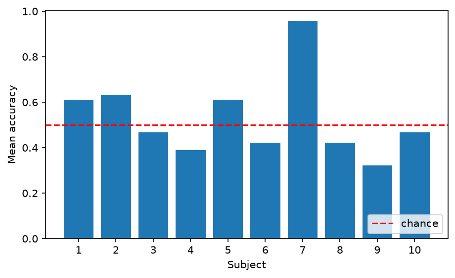

# Neuroscience & Medical Device Portfolio

Three small Python projects at the intersection of neuroscience, brain stimulation and medical device regulation. Built as a biomedical engineering student, learning as I go.

## 1. EEG motor imagery classifier (`01_motor_imagery_baseline.py`, `02_multi_subject.py`)

Classifies imagined left-hand vs right-hand movement from EEG, using the public PhysioNet EEG Motor Movement/Imagery dataset.

- Pipeline: band-pass filter (7-30 Hz), epoching, CSP features, LDA classifier, cross-validation (MNE-Python + scikit-learn)
- Run on 10 subjects: mean accuracy **0.530** (chance is about 0.50)
- One subject (7) reached 0.956. Most of the others were close to chance.
 - Checked against 29 worked examples from the official EU guidance (MDCG 2021-24 Rev.1, April 2026). On the first run 25 matched. That exposed one bug (devices that control active implants) and missing Rule 8 triggers (joint replacements, breast implants and meshes, spinal and dental implants). After fixing them, all 29 match.
- Caveat: I fixed the rules while looking at these same examples, so this shows agreement with the guidance, not accuracy on unseen devices. The yes/no facts for each device are my reading of its intended use. Many rule triggers are still not coded. **Not regulatory advice.**
- Reproduce with `python3 04_validate_mdcg.py`



## 2. EU MDR device classifier (`03_device_classifier.py`)

A rule-based tool that assigns an EU MDR risk class (I, IIa, IIb, III) to a device described by yes/no facts. It checks every rule and takes the highest class, following Annex VIII of Regulation (EU) 2017/745.

- Rules coded so far: 1, 8, 9, 10, 13 and 22, plus the 2022 reclassification of brain stimulators with no medical purpose
- Example: the same TMS device is class IIb for treatment but class III for research-only use
- Limitations: simplified, with many rule triggers not coded yet. The yes/no facts for each device are judgement calls. **Not yet validated against real products. Not regulatory advice.**

## 3. Planned: TMS vs tDCS meta-analysis dashboard

An interactive tool to compare published results on TMS and tDCS for depression, including how much the evidence varies between studies. Not started yet.

## Run it

```bash
python3 -m venv .venv
source .venv/bin/activate
pip install -r requirements.txt
python3 02_multi_subject.py     # downloads EEG data on first run, takes several minutes
python3 03_device_classifier.py
```
