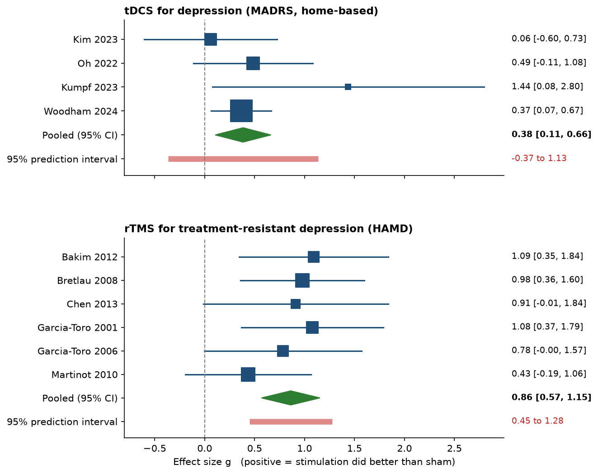

# Neuroscience & Medical Device Portfolio

Three small Python projects at the intersection of neuroscience, brain stimulation and medical device regulation. Built as a biomedical engineering student, learning as I go.

## 1. EEG motor imagery classifier (`01_motor_imagery_baseline.py`, `02_multi_subject.py`)

Classifies imagined left-hand vs right-hand movement from EEG, using the public PhysioNet EEG Motor Movement/Imagery dataset.

- Pipeline: band-pass filter (7-30 Hz), epoching, CSP features, LDA classifier, cross-validation (MNE-Python + scikit-learn)
- Run on 10 subjects: mean accuracy **0.530** (chance is about 0.50)
- One subject (7) reached 0.956. Most of the others were close to chance.
- Limitations: only about 45 trials per subject, so each test split holds about 9 trials and accuracy is very noisy. This simple pipeline works for a few people, not most.

## 2. EU MDR device classifier (`03_device_classifier.py`, `04_validate_mdcg.py`)

A rule-based tool that assigns an EU MDR risk class (I, IIa, IIb, III) to a device described by yes/no facts. It checks every rule and takes the highest class, following Annex VIII of Regulation (EU) 2017/745.

- Rules coded so far: 1, 8, 9, 10, 13 and 22, plus the 2022 reclassification of brain stimulators with no medical purpose
- Example: the same TMS device is class IIb for treatment but class III for research-only use
- Checked against 29 worked examples from the official EU guidance (MDCG 2021-24 Rev.1, April 2026). On the first run 25 matched. That exposed one bug (devices that control active implants) and missing Rule 8 triggers (joint replacements, breast implants and meshes, spinal and dental implants). After fixing them, all 29 match.
- Caveat: I fixed the rules while looking at these same examples, so this shows agreement with the guidance, not accuracy on unseen devices. The yes/no facts for each device are my reading of its intended use. Many rule triggers are still not coded. **Not regulatory advice.**
- Reproduce with `python3 04_validate_mdcg.py`

## 3. Planned: TMS vs tDCS meta-analysis dashboard

## 3. TMS vs tDCS meta-analysis (in progress)

A random-effects meta-analysis written from scratch in Python (files `05` to `09`), applied to published trials of tDCS and rTMS for depression. An interactive dashboard on top of it is the next step.

- Data: 4 home-based tDCS trials and 6 rTMS add-on trials for treatment-resistant depression, copied from the forest plots of two published meta-analyses (`studies_*.csv`). These are secondary data, not re-extracted from the original trials.
- Validation: the code reproduces both published pooled results (tDCS -2.74 MADRS points [-4.19, -1.29]; rTMS SMD 0.86 [0.57, 1.15]). The rTMS paper's discussion section quotes a different number (0.97) from its own figure, and the code agrees with the figure.
- Finding: on a common standardized scale, tDCS g = 0.38 and rTMS g = 0.86. The tDCS 95% prediction interval (-0.37 to 1.13) crosses zero, so a new trial could show no benefit. The rTMS interval does not, but it rests on 6 small, older trials where the estimated variation between trials is exactly zero, so it should be read as a minimum.
- Limitations: very few trials; different scales, populations and eras, so the two treatments are not directly comparable; the DerSimonian-Laird method is unreliable with so few studies.

Reproduce with `python3 05_meta_analysis.py`, then `06_tms_check.py`, `07_compare.py`, `08_prediction_interval.py` and `09_forest_plot.py`.